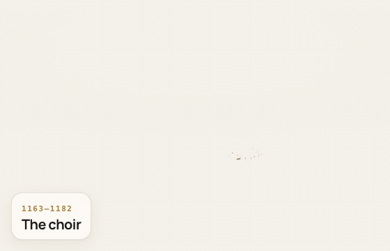
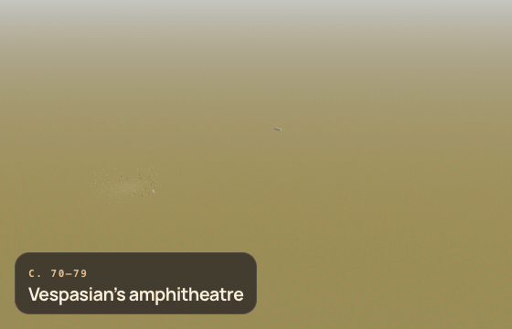
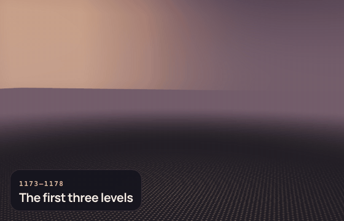
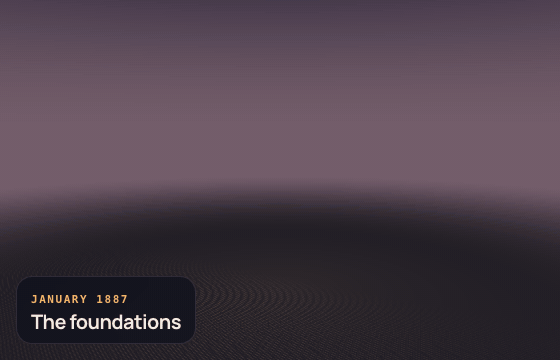
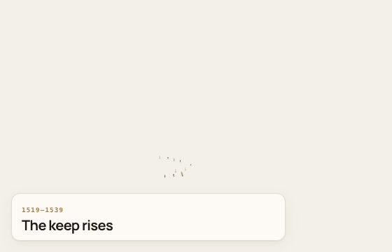

<h1 align="center">Monument</h1>

<p align="center"><b>A skill that builds any named building stone by stone, on its real plan, with every phase dated and sourced.</b><br>Runs in Claude Code, Codex, OpenCode and Antigravity.</p>

<p align="center">
  <a href="https://gleaming0427.github.io/monument/"><b>Website and live collection</b></a> ·
  <a href="#quick-start">Quick start</a> ·
  <a href="#usage">Usage</a> ·
  <a href="#how-it-works">How it works</a> ·
  <a href="#community-gallery">Community gallery</a> ·
  <a href="#install">Install</a> ·
  <a href="#limits">Limits</a>
</p>

<p align="center"></p>
<p align="center"><sub><code>examples/notre-dame-de-paris.json</code>: the choir of 1163, the nave, the west front and its towers, the roses and flying buttresses, the great organ of 1733, the spire pulled down in 1792, Viollet-le-Duc's spire of 1859, the fire of 15 April 2019 and the rebuilding; inside, the oak frames, the vaults and the choir screens.</sub></p>

---

Name a building, and Claude researches its history, places it on its real plan, reads its architecture from photos and builds it as a live 3D scene you can turn and move through time. Thousands of small solid pieces drop into place, phase after dated phase; construction moments are pinned on the pieces they concern; every date and figure links to its source.

## Quick start

```sh
npx skills add Gleaming0427/monument
```

The CLI asks which agents to set up (Claude Code, Codex, OpenCode, Antigravity). Then, in any folder:

```text
/monument Himeji Castle, Himeji, Japan
```

In Codex, type `$monument`. No API keys and nothing to `npm install`: the viewer, Three.js and the fonts ship with the skill. It needs Node 20 or later.

## Usage

Name the building, its city and its country. Deciding how to build it is Claude's job.

```text
/monument Taj Mahal, Agra, India
/monument Notre-Dame de Paris, from 1163 to the 2024 reopening
/monument Mont-Saint-Michel, the abbey and the village
$monument Sagrada Família, Barcelona
```

Claude writes `monuments/<id>.json` in your folder, starts the local viewer and opens `http://127.0.0.1:4173/#<id>`. You can also start the viewer yourself:

```sh
node ~/.claude/skills/monument/scripts/serve.mjs monuments
```

The first measured draft can also be generated directly:

```sh
node ~/.claude/skills/monument/scripts/scaffold.mjs "Palais consulaire de Toulouse, Toulouse, France" --out monuments
```

This downloads the named building's OpenStreetMap footprint, selects an architecture family and writes an oriented, detailed base shell plus its control plan. Framed openings, mullions, doors, cornices and roof edges are generated immediately. It stops instead of substituting a nearby building when no usable footprint can be found.

## How it works

One rule sits at the top of [`SKILL.md`](SKILL.md): **the building is the evidence.**

1. **Size it**: a building, an ensemble or a whole site, with a time estimate. A whole site never starts without you.
2. **Identify it**: name, address, historic names, sources in the local language.
3. **Generate its measured skeleton**: `scaffold.mjs` resolves and downloads the footprint, converts it to metres, chooses a broad family and produces detailed base volumes in seconds ([references/scaffold.md](references/scaffold.md)).
4. **Read the architecture**: replace its explicit estimates using three useful views and the details that make it recognisable ([references/fidelity.md](references/fidelity.md)).
5. **Write the timeline**: dated, sourced phases and construction moments ([references/format.md](references/format.md)).
6. **Build it from bricks**: generators that turn each element into small solid pieces, square or turned (columns stand on their bases with drums, entasis and the capital of their order), then sourced human-scale worksite tableaux add workers, materials, hoists, scaffolds, dust and sparks to the relevant phases ([references/bricks.md](references/bricks.md)). A new kind of architecture gets a new brick.
7. **Lay the carving from photographs**: sculpture too fine to build piece by piece (tympana, galleries of statues, roses) is a free photo from Wikimedia Commons, measured, straightened onto the model and given its depth back, a portal's splay included, and credited ([references/bricks.md](references/bricks.md)).
8. **Close it and build the inside**: no wall or roof is left open; vaults, the roof frame of its country and century and the interior works that marked its history (an altar, a choir screen, an organ) are built in their phase. The viewer's section view (the **Section** button, or `?section`) cuts the building open on the camera's side, and moments set inside open it on their own.
9. **Compare with the photos**: each reference photo's viewpoint is fitted on lines recognised in it (`calibrate.mjs`), then a standard build uses one focused capture pass; publication adds the complete second pass.
10. **Report honestly**: what is measured, documented and interpreted, and what still differs.

## The collection

The world's most recognised monuments, built one by one. Each animation is recorded from the live viewer with `scripts/record.mjs`.

| | |
|---|---|
| <a href="https://gleaming0427.github.io/monument/view/#notre-dame-de-paris"></a><br><b>Notre-Dame de Paris</b>, 1163–2025 | <a href="https://gleaming0427.github.io/monument/view/#colosseum"></a><br><b>Colosseum</b>, Rome |
| <a href="https://gleaming0427.github.io/monument/view/#leaning-tower-of-pisa"></a><br><b>Leaning Tower of Pisa</b>, Italy | <a href="https://gleaming0427.github.io/monument/view/#eiffel-tower"></a><br><b>Eiffel Tower</b>, Paris |
| <a href="https://gleaming0427.github.io/monument/view/#chateau-de-chambord"></a><br><b>Château de Chambord</b>, France | |

Every one is live on the [website](https://gleaming0427.github.io/monument/collection/).

## Community gallery

Built a monument you like? In the same session, ask your agent:

```text
publish this monument to the community gallery
```

It asks for a title, an id and your GitHub name, shows what it will send, and opens a pull request that adds `community/<id>/`. Without a terminal, use the [Submit a monument](https://github.com/Gleaming0427/monument/issues/new?template=submit-monument.yml) form with a Gist. The site checks every file, rebuilds the monument and photographs it. See [CONTRIBUTING.md](CONTRIBUTING.md).

## Install

Monument is a standard [Agent Skill](https://agentskills.io): this repository is the skill folder.

| | Command |
|---|---|
| skills CLI, for you | `npx skills add Gleaming0427/monument -g` (add `-a claude-code`, `-a codex`, `-a opencode` or `-a antigravity` to skip the question) |
| skills CLI, for one project | `npx skills add Gleaming0427/monument` |
| git, Claude Code | `git clone https://github.com/Gleaming0427/monument.git ~/.claude/skills/monument` |
| git, Codex | `git clone https://github.com/Gleaming0427/monument.git ~/.agents/skills/monument` |
| No git | [Download the ZIP](https://github.com/Gleaming0427/monument/archive/refs/heads/main.zip) and unzip it into your skills folder as `monument` |

## Repository

```
SKILL.md            the skill: what Claude does when you ask for a building
references/         monument file format, real-plan method, fidelity loop, bricks
kit/                the viewer: engine (builder.js), interface, Three.js and fonts, vendored
scripts/            scaffold, serve, validate, capture, compare, calibrate, relief, record, publish, build-site
examples/           the collection
community/          the community gallery, one folder per monument
site/               the website, deployed to GitHub Pages, English
i18n/               the words of the site and of each monument, by language
```

The pages are written in English. Every other language is a dictionary rendered into its own folder at build
time, so `/fr/` is a real French site for a crawler and for a link that can be shared. Mark the text on a page
with `data-i18n="key"` (or `data-i18n-html` when the sentence carries markup, `data-i18n-title` and friends for
an attribute), put the translation in `i18n/site/<language>.json`, and the build refuses to ship a page with a
key left unanswered. The viewer reads its own language off its `<html lang>`.

A monument's own words — phase titles and texts, the anecdotes beside the timeline, the labels by the height,
the note on what is measured — live in `i18n/monuments/<language>/<id>.json`, and the build writes
`<id>.<language>.json` beside the English monument. What a language does **not** change is the evidence: dates,
measurements, sources and the order of the phases are the same file whichever language reads them.
`node scripts/monument-i18n.mjs skeletons <language>` writes a file to fill in,
`node scripts/monument-i18n.mjs check [<language>]` says what is missing and refuses a translation that drops or
invents a figure. `node scripts/i18n.test.mjs` holds both to that.

`node scripts/validate.mjs` checks every monument and that every brick is documented. `node scripts/align-scan.mjs` aligns a captured scan (photogrammetry, laser, gaussian splats) to a monument and reports, element by element, how far the model stands from it; the viewer's **Captured** button then shows the building as it was captured ([references/capture.md](references/capture.md)). Gothic monuments can ask for `"masonry": "mesh"`: walls, arches, mouldings, tracery, roofs, balustrades and spires are then real continuous surfaces cut by the true outline of their openings, with joints drawn at the size of the photographed courses, not heaps of blocks ([references/geometry.md](references/geometry.md#continuous-masonry)). `node scripts/chronology.mjs` holds each film to its own story: phases in date order, moments in the order the film reaches them, every card pinned on masonry that stands when it shows.

## Limits

- **It is only as good as the record.** A documented history and good photos give a good model; a thin record gives a short timeline, labelled as such.
- **A focused building starts immediately.** The automatic scaffold produces a measured, viewable base in seconds; a researched standard result usually targets 8–15 minutes by spending manual work on the building's real history and distinctive details. A new complex signature brick may still take 20–35 minutes.
- **Shapes come from bricks.** A new kind of architecture needs a new brick; the first version states its deliberate simplifications.
- **It is a model, not a survey.** Footprints and heights are measured; facades, roofs and the split between periods are read from sources and photos.

## Credits

Made by [@Gleaming0427](https://x.com/Gleaming0427) with Claude Code.

The format of this skill, of its install and of its website follows [Anatomy](https://skills.wheresryan.sh/anatomy) by Ryan. The carving of Notre-Dame's west front is photographed: the gallery of kings and the west rose by Dietmar Rabich ([1](https://commons.wikimedia.org/wiki/File:Paris,_Notre_Dame_--_2014_--_1458-65.jpg), [2](https://commons.wikimedia.org/wiki/File:Paris,_Notre_Dame_--_2014_--_1446.jpg)) and the portals and statues by The wub ([3](https://commons.wikimedia.org/wiki/File:Notre_Dame_west_facade_2025-09-02_-_01.jpg)), all CC BY-SA 4.0; inside, the choir screens by Zairon ([4](https://commons.wikimedia.org/wiki/File:Paris_Cath%C3%A9drale_Notre-Dame_Innen_S%C3%BCdliche_Chorschranke_1.jpg), [5](https://commons.wikimedia.org/wiki/File:Paris_Cath%C3%A9drale_Notre-Dame_Innen_N%C3%B6rdliche_Chorschranke_1.jpg), CC BY-SA 4.0) and the great organ by Ibex73 ([6](https://commons.wikimedia.org/wiki/File:Great_organ_of_Notre-Dame_de_Paris_2024_(1).jpg), CC BY 4.0); every relief's credit is in its monument file and in the viewer's evidence mode. Built with [Three.js](https://threejs.org) (MIT) and [Manrope](https://github.com/sharanda/manrope) (SIL Open Font License). Footprints and streets: © [OpenStreetMap](https://www.openstreetmap.org/copyright) contributors (ODbL) and IGN BD TOPO (Licence Ouverte). Each monument links to its own sources.

MIT licence.
